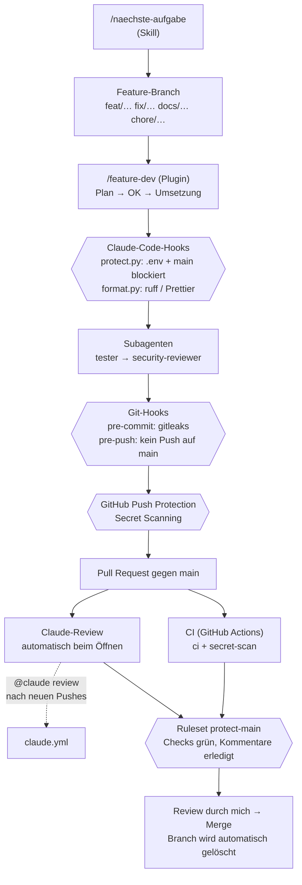

# Harness

Der Harness ist alles um den Code herum, was Qualität **automatisch** prüft statt sie nur zu versprechen: Agenten-Workflow in Claude Code, lokale Schutzmechanismen, CI und Review auf GitHub.

## Ablauf einer Änderung



## Bausteine

| Ebene | Baustein | Datei | Aufgabe |
|---|---|---|---|
| Claude Code | Skill `naechste-aufgabe` | `.claude/skills/naechste-aufgabe/` | Fester Ablauf: Roadmap → Branch → Plan → Umsetzung → Tests → PR |
| Claude Code | Subagent `tester` | `.claude/agents/tester.md` | Tests schreiben und starten (nur Demo-Daten) |
| Claude Code | Subagent `security-reviewer` | `.claude/agents/security-reviewer.md` | Diff auf Secrets, Token-Lecks, Scraping prüfen |
| Claude Code | Subagent `erklaerer` | `.claude/agents/erklaerer.md` | Änderung zum Lernen erklären |
| Claude Code | Plugins | `~/.claude/settings.json` | feature-dev, ralph-loop, code-review, commit-commands, security-guidance, pyright-lsp, typescript-lsp |
| Claude Code | Hook `protect.py` (PreToolUse) | `.claude/hooks/protect.py` | Blockt Zugriff auf `.env*` (außer `.env.example`), `git commit`/`git push` auf `main`, `--no-verify` und gitleaks-Läufe ohne `--redact` oder über den Arbeitsordner |
| Claude Code | Hook `format.py` (PostToolUse) | `.claude/hooks/format.py` | Formatiert geänderte Dateien mit ruff (backend) bzw. Prettier (frontend), sobald installiert |
| Git lokal | `pre-commit` | `.githooks/pre-commit` | gitleaks prüft die gestagten Änderungen – ein Secret wird gar nicht erst committet |
| Git lokal | `pre-push` | `.githooks/pre-push` | Lehnt Pushes auf `main` ab – zusätzliche Schicht zur Branch Protection, fällt schon lokal auf |
| GitHub | CI | `.github/workflows/ci.yml` | Siehe nächster Abschnitt |
| GitHub | Claude-Review | `.github/workflows/claude-review.yml` | Review beim Öffnen eines PRs und bei `ready_for_review`; Drafts übersprungen; max. 30 Turns / 15 min; darf nur `gh pr view/diff/comment`, Inline-Kommentare und Read/Glob/Grep (keine Schreib-Tools) |
| GitHub | `@claude` | `.github/workflows/claude.yml` | Aufgaben per `@claude` in PRs und Issues (z. B. „@claude review“); max. 25 Turns / 30 min; darf auf eigene `claude/…`-Branches pushen (`contents: write`), `main` schützt das Ruleset |
| GitHub | Dependabot | `.github/dependabot.yml` | Hält Actions, Python- (uv) und npm-Pakete sowie Docker-Images (Dockerfile, Compose) aktuell; wöchentlich, 7 Tage Wartezeit nach einem Release |
| GitHub | Ruleset `protect-main` | Repo-Einstellungen | Branch Protection auf `main`, siehe unten |
| GitHub | Secret Scanning + Push Protection | Repo-Einstellungen | GitHub lehnt Pushes mit erkannten Secrets ab und meldet Funde |
| GitHub | Dependabot-Alerts | Repo-Einstellungen | Meldet bekannte Sicherheitslücken in Abhängigkeiten |

Beide Claude-Workflows reagieren nur auf den Repo-Owner (schützt das Pro-Kontingent) und nur auf Issues/PRs, die der Owner selbst angelegt hat – Claude liest so keine fremden Texte und keinen Code aus fremden Forks (Schutz vor Prompt-Injection), und laufen über das **Pro-Abo** (Secret `CLAUDE_CODE_OAUTH_TOKEN`), nicht über die API.

## CI

| Job | Läuft wenn | Prüft |
|---|---|---|
| `detect` | immer | Welche Teile existieren (`backend/pyproject.toml`, `frontend/package.json`, `Dockerfile`) |
| `backend` | `backend/` existiert | `ruff check`, `ruff format --check`, `pyright`, `pytest` |
| `frontend` | `frontend/` existiert | `npm run lint` (ESLint), `npm run format:check` (Prettier), `npm run typecheck` (tsc), `npm test` (Vitest) |
| `docker` | `Dockerfile` existiert | Image baut (ohne Push) |
| `secret-scan` | immer | gitleaks über die **ganze** Git-Historie |
| `ci` | immer | Sammel-Check: rot, wenn einer der Jobs oben fehlschlägt; übersprungene Jobs zählen als bestanden |

Die **required checks** sind nur `ci` und `secret-scan` – stabil, egal welche Jobs noch dazukommen.

Vertrag für das Projektgerüst: Das Frontend muss die npm-Skripte `lint`, `format:check`, `typecheck` und `test` (einmaliger Lauf, kein Watch-Modus) anbieten; das Backend `ruff`, `pyright` und `pytest` als Dev-Abhängigkeiten in `pyproject.toml`.

Alle Actions sind auf **Commit-SHAs gepinnt** (Version als Kommentar). Ein Tag kann umgehängt werden, ein SHA nicht.

## gitleaks-Regeln

- Immer mit `--redact` – Funde erscheinen nur geschwärzt.
- Nur über Git scannen: `gitleaks git --redact .` (Historie) oder `gitleaks git --pre-commit --staged --redact .` (Hook). **Nie** `gitleaks dir` über den Arbeitsordner – der enthält die echte `.env`.
- `protect.py` blockt beides für Claude.

## Einrichtung (einmalig pro Rechner)

```bash
# 1. Git-Hooks aktivieren
git config core.hooksPath .githooks

# 2. gitleaks installieren – in einem Temp-Ordner, Prüfsumme vor dem Installieren verifizieren
cd "$(mktemp -d)"
V=8.30.1
SHA256=551f6fc83ea457d62a0d98237cbad105af8d557003051f41f3e7ca7b3f2470eb  # wie GITLEAKS_SHA256 in ci.yml
gh release download v$V -R gitleaks/gitleaks -p "gitleaks_${V}_linux_x64.tar.gz"
echo "$SHA256  gitleaks_${V}_linux_x64.tar.gz" | sha256sum -c -
tar -xzf gitleaks_${V}_linux_x64.tar.gz gitleaks && install -m 0755 gitleaks ~/.local/bin/gitleaks
cd -

# 3. Claude-Token fürs Repo (Pro-Abo, einmalig)
claude setup-token
gh secret set CLAUDE_CODE_OAUTH_TOKEN
```

gitleaks-Version und Prüfsumme in `.github/workflows/ci.yml` (`GITLEAKS_VERSION`, `GITLEAKS_SHA256`) und hier gleich halten. Bei einem Update: neuen SHA256 einmal gegen `checksums.txt` des Releases prüfen und an beiden Stellen eintragen. Die Prüfsumme steht fest im Repo, weil eine Datei aus demselben Release ein manipuliertes Release nicht erkennen würde.

## Bekannte Grenzen der lokalen Hooks

Die lokalen Hooks sind ein Sicherheitsnetz gegen Versehen, keine Festung:

- `protect.py` prüft Text, keine echte Shell: Dateinamen wie `prod.env` oder Shell-Globs (`cat .en?`) erkennt es nicht. Erwähnt ein Befehl `.env` nur im Text (z. B. Commit-Message), wird er trotzdem geblockt – lieber einmal zu vorsichtig.
- Bei unlesbarer Eingabe blockt `protect.py` (fail-closed); `format.py` blockt nie.
- `git … --no-verify` umgeht die Git-Hooks. Claude darf das nicht (`protect.py` blockt es), ich selbst könnte es. Endgültig schützen die CI (`secret-scan`), GitHubs Push Protection und die Branch Protection auf GitHub.
- Der lokale `pre-push`-Hook greift nicht im GitHub-Runner – dort schützt nur das Ruleset `main` vor `claude.yml`. Die Action holt sich per OIDC (`id-token: write`) einen Token der Claude GitHub App; dessen Rechte bestimmt die App-Installation, nicht allein der `permissions:`-Block. Die echte Grenze sind also Ruleset + App-Rechte. Andere Branches und Tags schützt das Ruleset nicht.
- Die `deny`-Regeln in `.claude/settings.json` nennen nur konkrete Namen (`.env`, `.env.local`, `.env.*.local`, `.env.production`), weil `deny` immer Vorrang hat und ein Muster wie `.env*` auch `.env.example` sperren würde. Alle übrigen Varianten fängt `protect.py` ab.

## Branch Protection

Das Repo ist öffentlich – dadurch ist Branch Protection auch im kostenlosen Plan verfügbar (Entscheidung in `docs/ENTSCHEIDUNGEN.md`). Ruleset **`protect-main`** auf dem Default-Branch, ohne Bypass-Akteure:

- Merge nach `main` nur per Pull Request
- Required checks: `ci`, `secret-scan` – der Branch muss auf dem aktuellen Stand von `main` sein
- Offene Review-Kommentare müssen erledigt sein
- Keine Force-Pushes, kein Löschen von `main`

Dazu: gemergte Branches werden automatisch gelöscht (`delete_branch_on_merge`), Secret Scanning mit Push Protection und Dependabot-Alerts sind an. Lokal blocken weiterhin der `pre-push`-Hook und `protect.py` Pushes auf `main` – so fällt ein Versehen schon vor dem Push auf.
